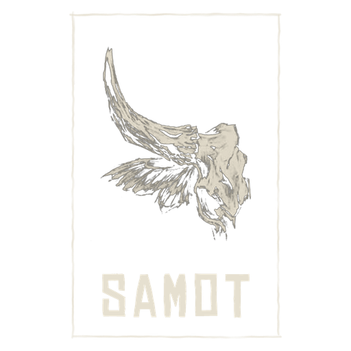
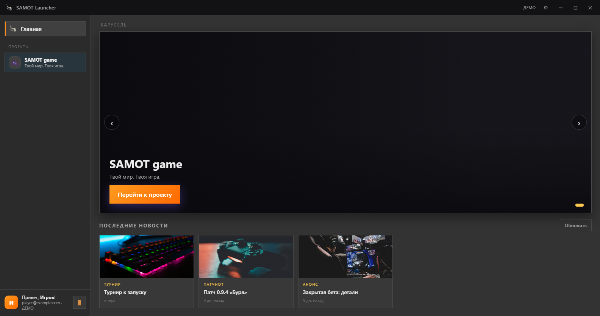
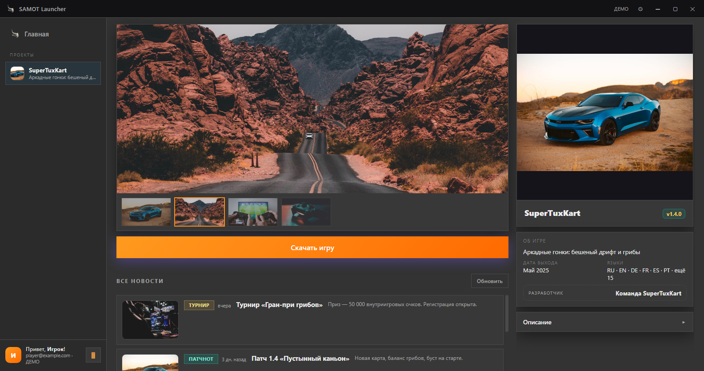
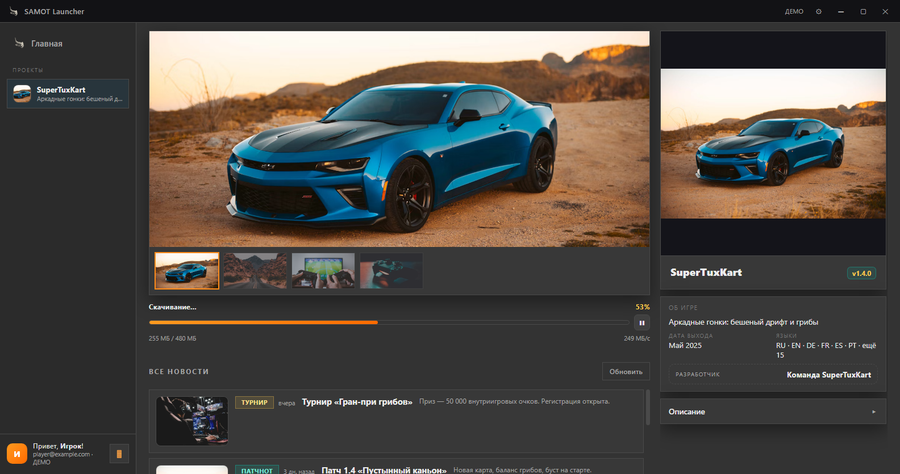
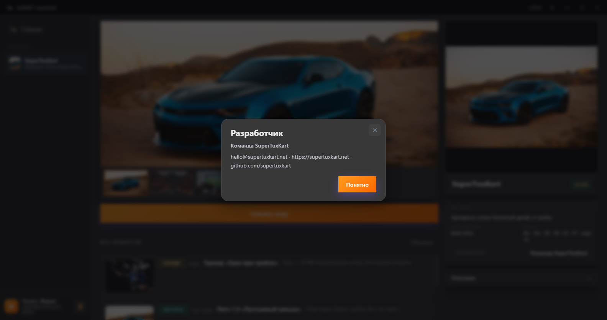
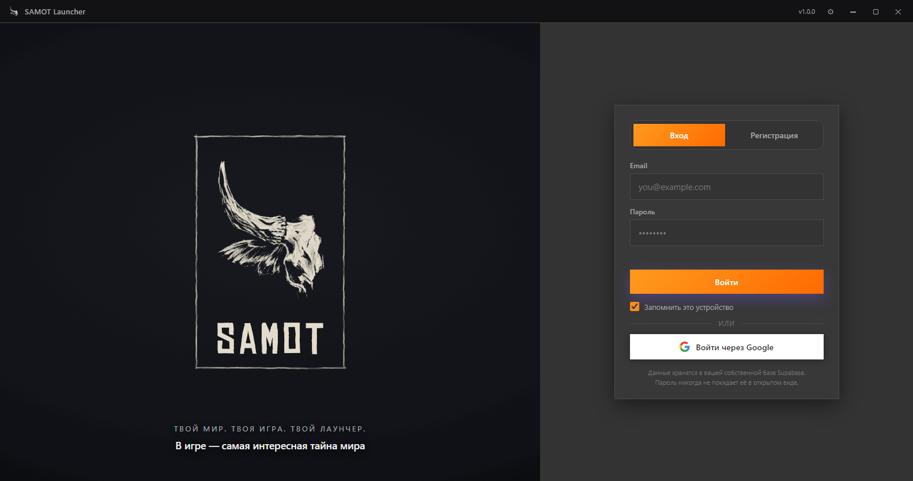

  

<h1 align="center">SAMOT Launcher</h1>

<b>Твой мир. Твоя игра. Твой лаунчер.</b>

  
  
  
  

---

## Что это

**SAMOT Launcher** — десктопный лаунчер, который превращает твою игру в доступный продукт: один установщик, автоматическое получение игры и её обновлений, новости и баннеры в одном окне, вход через Google или email.

Для игроков — только «Нажми «Скачать» и играй».

## Возможности

### Для игрока
- 🚀 **Одно окно — несколько игр**: переключение между проектами в сайдбаре
- 📰 **Новости и баннеры** прямо в лаунчере, карусель на главной
- 📦 **Дельта-обновления**: докачиваются только изменённые файлы, игра скачивается не целиком
- ⏸ **Пауза/продолжение** и **докачка с места обрыва**: перезапуски не обнуляют прогресс
- 🔍 **Проверка целостности**: SHA-256 каждого файла, битое перекачивается автоматически
- 🔐 Вход через Google или email, «Запомнить устройство», офлайн-режим
- 🌙 Тёмная тема.

## Скачать

| Что | Файл |
|---|---|
| **SAMOT Launcher** (игрок) | [SAMOT Launcher Setup.exe](https://github.com/RevacholFrend/samot-launcher/releases/latest/download/SAMOT-Launcher-Setup.exe) |

> ℹ Самоподписанный сертификат: при первом запуске Windows SmartScreen может предупредить.
> Исходный код открыт — проверяйте спокойно.

## Скриншоты

Демонстрационный проект «SuperTuxKart» (свободный kart-гонщик, GPLv3).

  
  

  
  

  

Требования: Windows 10+, Node.js LTS. Бэкенд — Supabase (см. `supabase/schema.sql`).

> Демо-иллюстрации: SuperTuxKart (свободный kart-гонщик, GPLv3) — учебный пример заполнения проекта. Изображения — Unsplash.

## Лицензия

MIT — см. [LICENSE](LICENSE).
