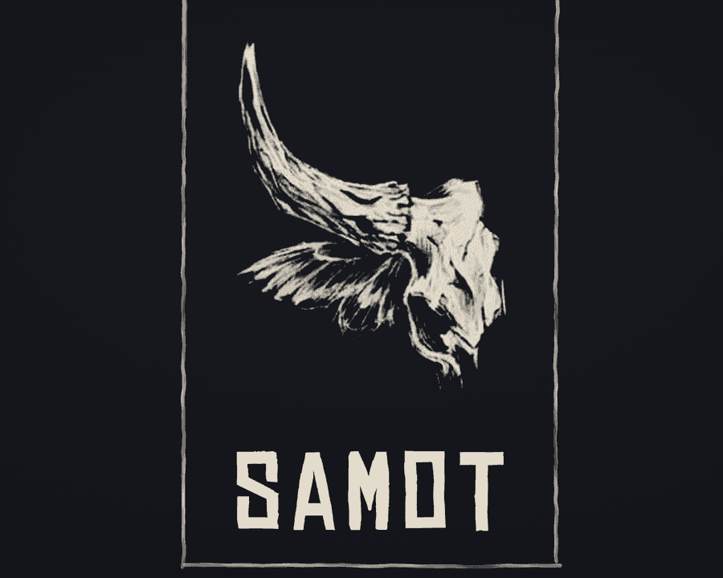
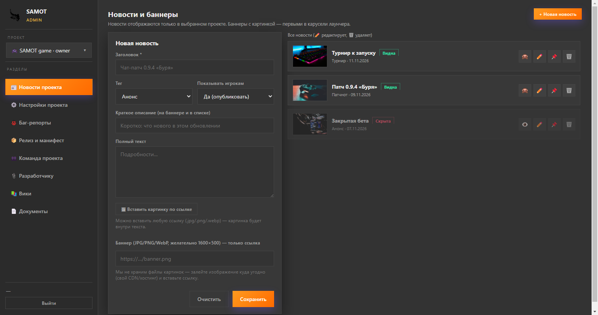
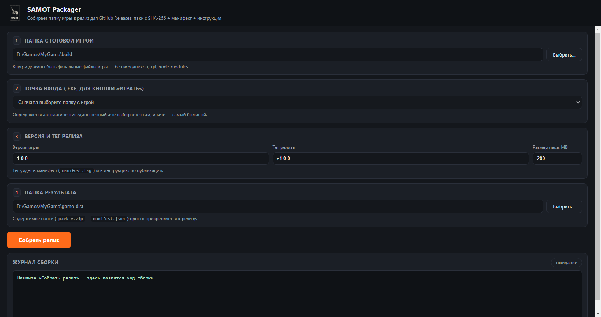

<p align="center">
  
</p>

<h1 align="center">SAMOT Launcher</h1>

<p align="center"><b>Твой мир. Твоя игра. Твой лаунчер.</b></p>

<p align="center">
  
  
  
  
</p>

---

## Что это

**SAMOT Launcher** — десктопный лаунчер, который превращает твою игру в продукт уровня Steam: один установщик, автоматическое получение игры и её обновлений, новости и баннеры в одном окне, вход через Google или email.

Для игроков — только «Нажми «Скачать» и играй». Для разработчика — админка с выпуском игры в два клика.

## Возможности

### Для игрока
- 🚀 **Одно окно — несколько игр**: переключение между проектами в сайдбаре
- 📰 **Новости и баннеры** прямо в лаунчере, карусель на главной
- 📦 **Дельта-обновления**: докачиваются только изменённые файлы, игра скачивается не целиком
- ⏸ **Пауза/продолжение** и **докачка с места обрыва**: перезапуски не обнуляют прогресс
- 🔍 **Проверка целостности**: SHA-256 каждого файла, битое перекачивается автоматически
- 🔐 Вход через Google или email, «Запомнить устройство», офлайн-режим
- 🌙 Тёмная тема, английский и русский интерфейс

### Для разработчика
- 🛠 **SAMOT Admin** — управление проектом без правки кода: новости, скриншоты, роли в команде, баны, аналитика
- 📦 **Релиз игры вместо часа возни**: SAMOT Packager пакует папку игры в GitHub Release и готовит манифест с контрольными суммами
- 🛰 Автообновление клиента у всех игроков без их участия
- 📎 Раздел «Материалы для разработчиков» прямо в админке

## Скачать

| Что | Файл |
|---|---|
| **SAMOT Launcher** (игрок) | [SAMOT Launcher Setup 1.0.0.exe](https://github.com/RevacholFrend/samot-launcher/releases/download/v1.0.0/SAMOT%20Launcher%20Setup%201.0.0.exe) |
| **SAMOT Admin** (разработчик) | [SAMOT Admin Setup 1.0.0.exe](https://github.com/RevacholFrend/samot-admin/releases/download/v1.0.0/SAMOT%20Admin%20Setup%201.0.0.exe) |
| **SAMOT Packager** (утилита сборки игры) | [SAMOT-Packager-1.0.0.exe](https://github.com/RevacholFrend/SAMOT-releases/releases/download/tools-v1.0.0/SAMOT-Packager-1.0.0.exe) |

> ℹ Самоподписанный сертификат: при первом запуске Windows SmartScreen может предупредить.
> Исходный код открыт — проверяйте спокойно.

## Скриншоты

<p align="center">
  
  
</p>
<p align="center">
  
  
</p>

## Как выпустить свою игру

1. Поставьте [SAMOT Admin](https://github.com/RevacholFrend/samot-admin) и попросите доступ к проекту у администратора.
2. Скачайте **SAMOT Packager** по ссылке выше — он подготовит релиз игры (паки + манифест).
3. Залейте содержимое `game-dist/` в GitHub Release с тегом `vX.Y.Z`.
4. В админке → «📦 Релиз и манифест»: владелец, репозиторий, тег, версия, вставить `manifest.json` → «Игра доступна для загрузки: Да».
5. Готово — игроки получат игру по кнопке «Скачать игру».

Больше в [samot-admin](https://github.com/RevacholFrend/samot-admin) и в самой админке (разделы «📚 Вики» и «📎 Разработчику»).

## Сборка из исходников

```bash
npm install
npm start          # запустить лаунчер
npm test           # тесты
npm run dist       # собрать установщик (dist/SAMOT Launcher Setup <version>.exe)
```

Требования: Windows 10+, Node.js LTS. Бэкенд — Supabase (см. `supabase/schema.sql`).

```
samot-launcher/
├─ main.js / preload.js   # главный процесс Electron
├─ src/                   # интерфейс игрока (тема, i18n, обновление)
├─ assets/                # лого, иконки, обои
├─ supabase/              # схема и миграции базы данных
└─ tests/                 # интегральные тесты и дымовой запуск
```

> Два репозитория держим синхронными по `src/config.js` и `src/documents.js` — при правках меняйте в обоих.

## Лицензия

MIT — см. [LICENSE](LICENSE).
